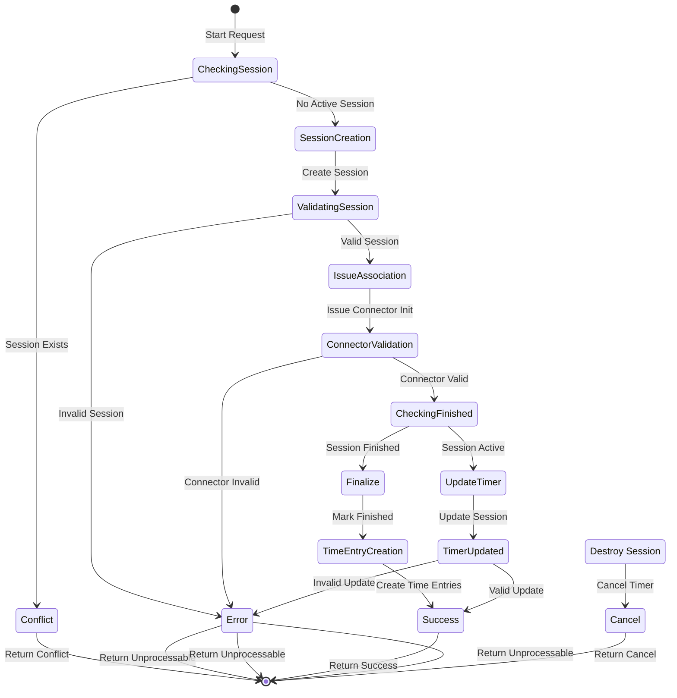

# Redmine-Tracky

Improved time tracking for Redmine (tested using Redmine 6.0)

## Prerequisites

- npm
- Bash [(>= 5.0)](https://www.gnu.org/software/bash/)
- MySQL or PostgreSQL [(>= 16)](https://www.postgresql.org/download/)
- Chromium or Chrome (system tests)
- Ruby [(= 3.3.7)](https://www.ruby-lang.org/en/downloads/)

## Development Setup

```sh
git clone https://github.com/renuo/redmine_tracky
cd redmine_tracky

bin/setup
```

`bin/setup` checks out Redmine (`REDMINE_VERSION`, default `7.0-stable`) into `tmp/redmine`,
links the plugin into it and seeds a PostgreSQL database on `127.0.0.1`.

Optional: Adjust `tmp/redmine/config/database.yml`

## Production Setup

```sh
git clone https://github.com/renuo/redmine_tracky plugins/redmine_tracky

RAILS_ENV=production rake redmine:plugins:redmine_tracky:install
```

### Configuration

Administration => Roles & Permissions

### Development

- Run: `bin/run` (`bin/dev` to also watch assets)
- Lint and test (incl. system tests): `bin/check`
- Additionally run Redmine's own tests: `bin/check --integration`

## Time Tracking Flow



## Contributing

Bug reports and pull requests are welcome on GitHub at https://github.com/renuo/redmine_tracky.
This project is intended to be a safe, welcoming space for collaboration, and contributors are expected to adhere to
the [code of conduct](https://github.com/renuo/redmine_tracky/blob/main/CODE_OF_CONDUCT.md).

## Copyright

Copyright 2021-2024 [Renuo AG](https://www.renuo.ch/), published under the MIT license.
